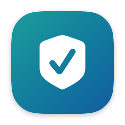
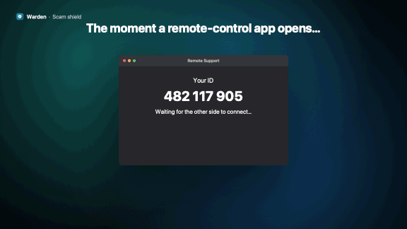
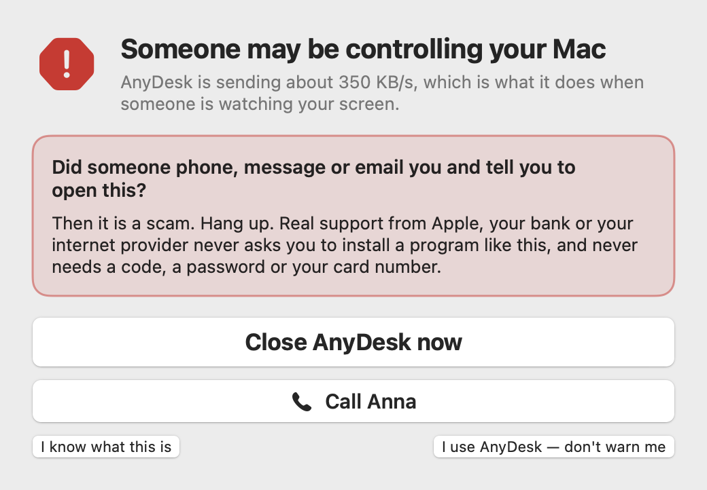
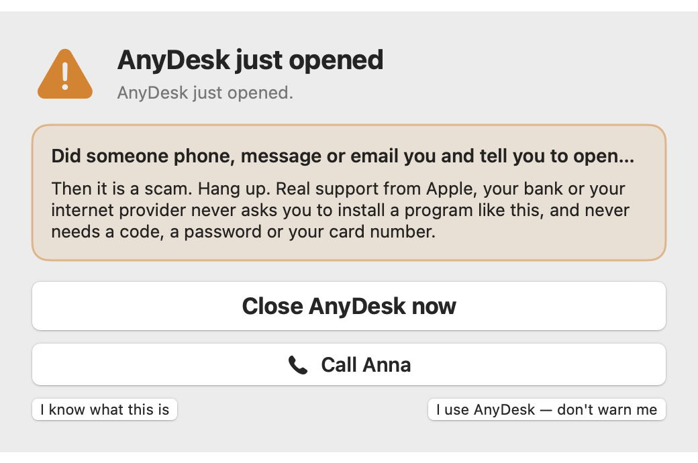
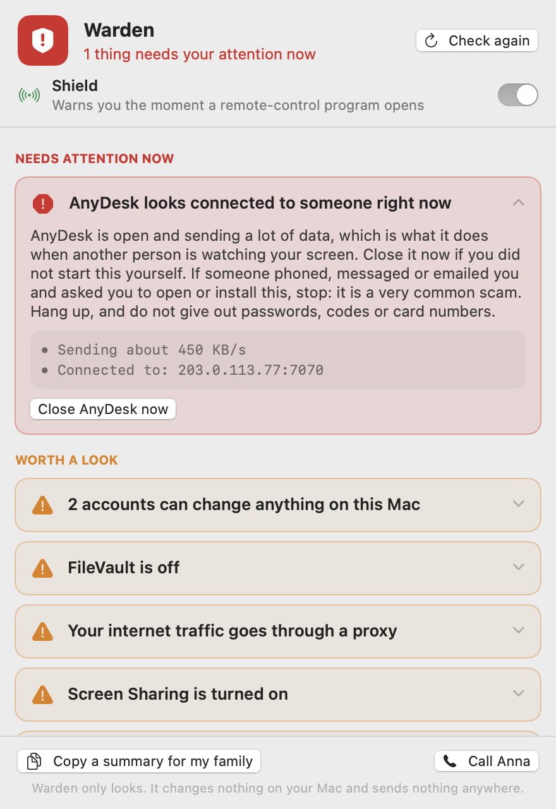
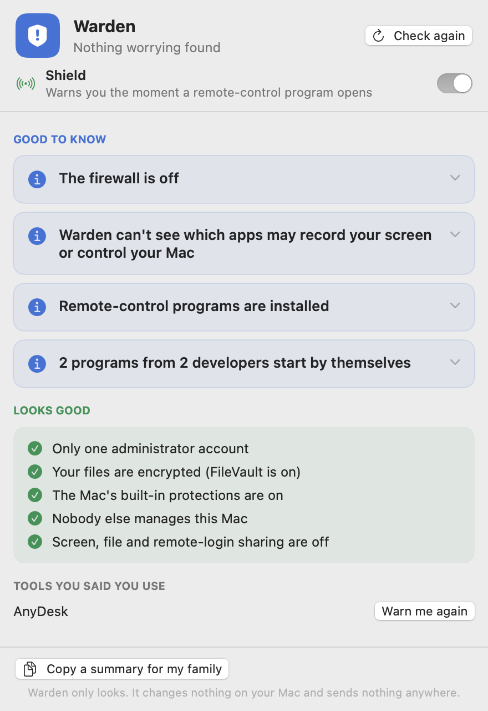
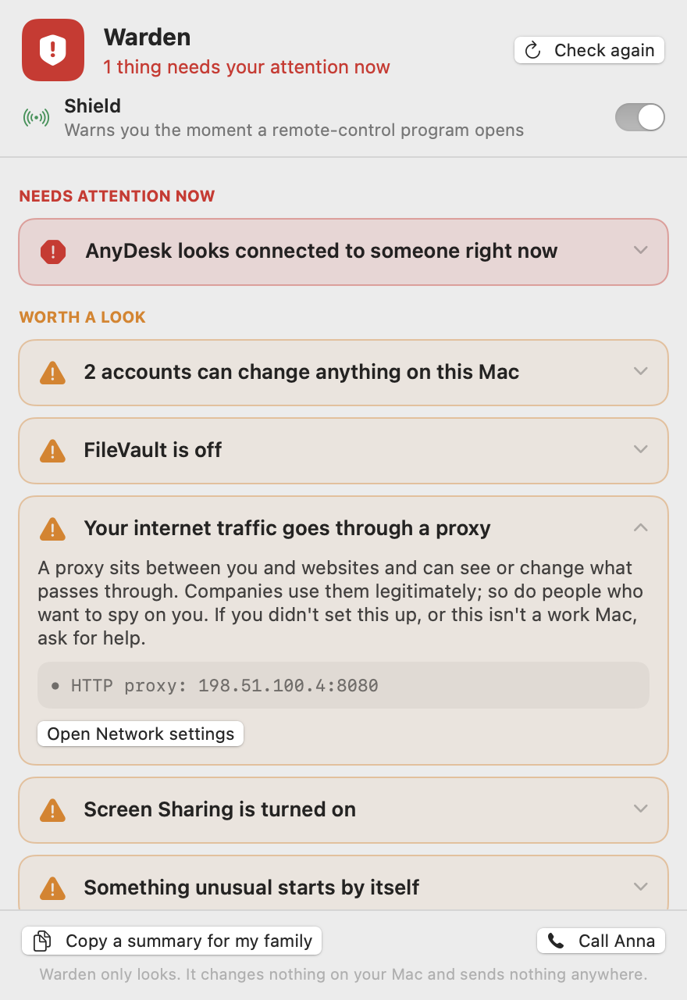

<div align="center">



# Warden — Mac Safety Check & Remote-Access Scam Shield

### Is someone remotely accessing my Mac? · AnyDesk & TeamViewer scam protection · Screen sharing, remote login & device management check · Proxies, startup items & privacy permissions · In plain English

**Warden is a free, open-source Safety Check for the Mac: it tells you in plain English who can see or control your computer, and puts up a stop sign the moment a remote-control app opens, which is how tech-support scams begin.**

[](https://github.com/PriyanshuGeTRekT/warden-mac-safety-check-scam-shield/releases/latest)
[](https://github.com/PriyanshuGeTRekT/warden-mac-safety-check-scam-shield/releases)
[](https://github.com/PriyanshuGeTRekT/warden-mac-safety-check-scam-shield/stargazers)
[](https://github.com/PriyanshuGeTRekT/warden-mac-safety-check-scam-shield/forks)
[](https://hits.sh/github.com/PriyanshuGeTRekT/warden-mac-safety-check-scam-shield/)
[](https://github.com/PriyanshuGeTRekT/warden-mac-safety-check-scam-shield/actions/workflows/build.yml)

[](https://github.com/PriyanshuGeTRekT/warden-mac-safety-check-scam-shield/issues)
[](https://github.com/PriyanshuGeTRekT/warden-mac-safety-check-scam-shield/commits/main)
[](LICENSE)


[](#option-2--install-with-homebrew)

[**⬇️ Download Warden**](https://github.com/PriyanshuGeTRekT/warden-mac-safety-check-scam-shield/releases/latest/download/Warden.zip) · [Website](https://priyanshugetrekt.github.io/warden-mac-safety-check-scam-shield/) · [Features](#features) · [Screenshots](#screenshots) · [Install](#installation) · [Command line](#command-line) · [FAQ](#faq)

<br>



</div>

---

## What is Warden?

iPhone has **Safety Check**: one place to see and cut off who and what can reach your device. **The Mac has nothing like it.** The answer to *"is someone in my computer?"* is a manual checklist spread over five System Settings panes and Terminal.

Meanwhile, the most common way people lose money to a computer scam isn't malware. A stranger phones, says the computer has a problem, and talks the person into **installing AnyDesk or TeamViewer and reading out a code**. The FBI's 2025 Internet Crime Report counts about **$1 billion lost to tech-support scams by people over 60** in the US alone.

**Warden** does two things:

- **Safety Check** — one screen that answers *"who can see or control this Mac?"* in plain words, with the evidence, and the right System Settings pane one click away.
- **Scam shield** — a menu-bar watcher. The moment a remote-control program opens, a **stop sign floats above every window**: *"Did someone phone, message or email you and tell you to open this? Then it is a scam. Hang up."*, with **Close it now** and **Call your helper**.

| | |
|---|---|
| 🗣️ **Plain English** | Every result says what it means and what to do, with the right setting one click away. |
| 👀 **Read-only** | Warden only looks. It changes nothing and needs no administrator password. |
| 🔒 **Private** | No network requests, no account, no telemetry. Nothing leaves your Mac. |
| 🎯 **Honest** | Severities that mean something, and it says plainly what it couldn't check. |
| 💸 **Free & open source** | MIT licensed. No subscription, no upsell. |

## Table of contents

- [What is Warden?](#what-is-warden)
- [Features](#features)
- [Screenshots](#screenshots)
- [Requirements](#requirements)
- [Installation](#installation)
- [Command line](#command-line)
- [How it decides](#how-it-decides-and-how-it-can-be-wrong)
- [Privacy and safety](#privacy-and-safety)
- [Known limitations](#known-limitations)
- [FAQ](#faq)
- [Roadmap](#roadmap)
- [Contributing](#contributing)
- [License](#license)

## Features

### 🛑 Scam shield

- Recognises about **20 remote-control tools**: AnyDesk, TeamViewer (including QuickSupport), RustDesk, ScreenConnect, Splashtop, LogMeIn / GoTo, Zoho Assist, UltraViewer, Supremo, Ammyy, RemotePC, Chrome Remote Desktop, VNC, NoMachine, DWService and more.
- The moment one opens, a **stop sign floats above every window** with **Close it now**, **Call your helper** and **I use this one**.
- When the tool starts **streaming your screen**, the alert escalates to *"Someone may be controlling your Mac"*.
- Tools you really use (say, for work) get a quiet note instead of a stop sign.

### ✅ Safety Check

One screen covering:

- **Remote-control programs** — installed, recently installed, open now, leftover helpers.
- **Sharing** — screen sharing, file sharing, remote login, and whether each is open to the network or only to this Mac.
- **Who manages this Mac** — device management (MDM) profiles.
- **Protection basics** — FileVault, Gatekeeper, System Integrity Protection, the firewall, automatic login, the guest account, screen lock.
- **Internet tampering** — proxies, and a bank's address redirected in `/etc/hosts`.
- **Things that start by themselves** — unsigned or hidden login items and launch agents.
- **What apps may see and do** — screen recording, accessibility, input monitoring, full disk access.
- **Accounts** — extra administrators and sign-ins from other computers.

### 🗣️ Plain English, with evidence

- Honest severities: **needs attention now**, **worth a look**, **good to know**, **looks good**.
- Every finding explains what it means for you, shows the evidence (app names, install dates, ports, data rates), and opens the right **System Settings** pane.
- **Close a remote-control app** right from the finding.
- **Copy a summary for my family** — plain text for whoever helps you with your computer.
- Says plainly what it **couldn't check**, and why, instead of pretending everything is fine.

### 💻 Command line

- `warden audit` prints the same Safety Check, with exit codes and `--json` for scripts.
- `warden watch` runs the shield in a terminal.
- Useful for the family IT person checking a parent's Mac.

## Screenshots

| Stop sign: someone may be controlling your Mac | Stop sign: a remote-control app just opened |
|:---:|:---:|
|  |  |

| Safety Check report | All clear | Findings with evidence |
|:---:|:---:|:---:|
|  |  |  |

<sub>Screenshots and the demo are rendered by the app itself from a simulated Mac, so no personal information appears in them.</sub>

## Requirements

- **macOS 14 Sonoma or later** (built and tested on macOS 27).
- **Apple silicon** Mac (M1 or newer).
- Optional: **Full Disk Access**, to include which apps may record the screen or control the Mac. Everything else works without any permission.
- To build from source: the Xcode Command Line Tools. Full Xcode is not needed.

## Installation

### Option 1 — Download the app

1. Download **[Warden.zip](https://github.com/PriyanshuGeTRekT/warden-mac-safety-check-scam-shield/releases/latest/download/Warden.zip)** from the latest release.
2. Unzip it and drag **Warden.app** into your **Applications** folder.
3. Open Warden. Because the app isn't notarized by Apple, macOS blocks the first launch:
   - open **System Settings › Privacy & Security**, scroll down and click **Open Anyway** next to Warden, or
   - run this once in Terminal:
     ```bash
     xattr -dr com.apple.quarantine /Applications/Warden.app
     ```
4. The shield icon appears in your menu bar. Click it and choose **Safety Check**.

### Option 2 — Install with Homebrew

```bash
brew tap priyanshugetrekt/warden https://github.com/PriyanshuGeTRekT/warden-mac-safety-check-scam-shield
```

```bash
brew install --cask priyanshugetrekt/warden/warden
```

The cask also links the `warden` command into your path. The first launch still needs **Open Anyway** (step 3 above).

### Option 3 — Build from source

1. Install the Command Line Tools if you don't have them:
   ```bash
   xcode-select --install
   ```
2. Clone the repository:
   ```bash
   git clone https://github.com/PriyanshuGeTRekT/warden-mac-safety-check-scam-shield.git
   ```
3. Build the app:
   ```bash
   cd warden-mac-safety-check-scam-shield && ./build.sh
   ```
4. Copy it into Applications and open it:
   ```bash
   ditto dist/Warden.app /Applications/Warden.app && open /Applications/Warden.app
   ```

To check everything, run the built-in self-test:

```bash
dist/Warden.app/Contents/MacOS/WardenBar --selftest
```

### Setting it up for a parent

1. Install Warden on their Mac, click the shield in the menu bar and tick **Open Warden when this Mac starts** at the bottom.
2. Set **your** name and number as their helper: `warden helper set Anna "+1 555 010 0199"`, or in the app. If [Hearth](https://github.com/PriyanshuGeTRekT/hearth-simple-mac-for-seniors) is installed, Warden uses Hearth's main helper automatically.
3. Run the Safety Check together once, and mark any remote-control tool they really use with **I use this one**.

### Uninstalling Warden

Click **Quit** at the bottom of Warden's menu, then move `/Applications/Warden.app` and `~/Library/Application Support/Warden` to the Trash.

## Command line

The `warden` command is inside the app at `Warden.app/Contents/Resources/bin/warden` (Homebrew links it for you).

```
warden audit            the Safety Check (exit code 0 fine · 1 worth a look · 2 needs attention now; --json for scripts)
warden summary          plain text to paste into a message
warden watch --notify   the shield in a terminal
warden tools            remote-control programs installed or open
warden close anydesk    close one (asks first)
warden trust anydesk    "I use this one": no stop sign when it opens
warden helper set Anna "+1 555 010 0199"
```

```
$ warden audit
Warden — Safety Check
2 things are worth a look
 ▲ A remote-control program was installed recently
     • AnyDesk — installed 2 days ago
 ▲ Your internet traffic goes through a proxy
 ✓ Your files are encrypted (FileVault is on)
 ✓ Nobody else manages this Mac
```

## How it decides (and how it can be wrong)

**Recognising a remote tool.** By bundle identifier, app name and executable path, against a table of about 20 products. Apple's own Remote Management is reported but never "closed". Names that look similar but aren't (Apple's `parsecd`, "Synchronize", Parallels) are tested not to match.

**"Connected" is not "someone is controlling you".** An idle AnyDesk keeps a connection to its company's servers open all day, so a connection alone would be a false alarm every time. Warden measures **how much data the program is sending**: a remote session streams your screen (hundreds of KB/s); an idle tool sends about a kilobyte a second. A session is *likely* when a tool keeps uploading at least 60 KB/s for two consecutive checks (about six seconds). The counters come from a background `nettop` that costs almost no CPU and needs no admin rights.

This is a heuristic: **a viewer watching a perfectly still screen sends little and can be missed**. That's why the *opening* of a tool is itself an alert, and why the Safety Check also lists tools that are merely installed.

**Honest severities.** A tool installed four months ago is *good to know*; installed in the last 14 days is *worth a look*; open right now is an alert only when it is actually sending. A tool you say you use gets a quiet note instead of a stop sign.

**What it can't see without help.** macOS keeps the list of which apps may record the screen or control the Mac in a database that needs *Full Disk Access*. Without it, Warden says so plainly (and offers the settings pane) instead of pretending that part is fine.

## Privacy and safety

- **No network requests of any kind.** Nothing is uploaded, no telemetry, no account.
- **Read-only.** Warden changes no settings and needs no administrator password. The only thing it ever does is close a remote-control app, and only when you click **Close it now** (or run `warden close`).
- It only closes the process it named, never anything else.
- The source is small and readable. Check it yourself.

## Known limitations

- **It is not antivirus.** It looks for remote-control tools and the common traces of tampering; it doesn't scan files for malware.
- **A scammer who talks someone through deleting Warden** or turning off the shield wins that round. Warden's job is to make the person stop at the first step ("it opened"), and to make calling a family member one click.
- **Closing a tool** uses SIGTERM, then SIGKILL. Parts of some tools run with administrator rights and refuse; Warden then says so and tells you to quit it from its own menu or Activity Monitor.
- **Not notarized.** The download needs the one-time "Open Anyway" step. Building from source avoids it.

## FAQ

### How do I know if someone is remotely accessing my Mac?
Run Warden. Its Safety Check looks for remote-control apps that are installed or open, screen sharing and remote login, extra administrator accounts and sign-ins from other computers. Its shield warns you the moment a remote-control app opens, and again if it starts streaming your screen.

### Is AnyDesk or TeamViewer on my Mac dangerous?
Not by itself: companies use them for IT support. But they are exactly what tech-support scammers ask people to install. If you didn't install one yourself, or someone on the phone told you to, remove it.

### Someone phoned me and asked me to install a program. What do I do?
Hang up. Real support from Apple, Microsoft, your bank or your internet provider never asks you to install a remote-control program or to read out a code, password or card number. Call someone you trust instead.

### Is there a Safety Check for Mac like on iPhone?
Not built in. Warden is a free Safety Check for the Mac: who can see or control it, explained in plain English.

### How do I check if screen sharing or remote login is on?
Warden's Safety Check reports screen sharing, file sharing, remote login and remote management, and whether each is open to the network, with a button that opens the right System Settings pane to turn it off.

### Does Warden need my password or send data anywhere?
No. Warden only reads, needs no administrator password, and makes no network requests at all.

### Why does macOS say Warden cannot be opened?
Warden is not notarized by Apple, so macOS blocks the first launch. Open **System Settings › Privacy & Security**, scroll down and click **Open Anyway** next to Warden. You only need to do this once.

### Is Warden antivirus?
No. It looks for remote-control tools and the common signs of tampering. It doesn't scan files for malware. macOS's built-in XProtect does that.

## Roadmap

- Notarized builds
- Alerts on a family member's iPhone when the shield fires (opt-in)
- More recognised tools and browser-based remote sessions
- More languages

Ideas and bug reports are welcome in [Issues](https://github.com/PriyanshuGeTRekT/warden-mac-safety-check-scam-shield/issues). See the [changelog](CHANGELOG.md) for what's new in each release.

## Contributing

See [CONTRIBUTING.md](CONTRIBUTING.md). In short: fork, build with `./build.sh`, run `./scripts/test.sh` and `--selftest` before and after your change, and open a pull request. Security issues: see [SECURITY.md](SECURITY.md).

```bash
./scripts/test.sh                                         # parsers, ~30 audit scenarios, shield sequences, live tests
dist/Warden.app/Contents/MacOS/WardenBar --render /tmp/screens   # PNGs of every screen
WARDEN_DEBUG=1 dist/Warden.app/Contents/MacOS/WardenBar   # logs what the shield sees to stderr
```

Everything the audit reads goes through the `SystemProbe` protocol (`LiveProbe` for the real Mac, `FakeProbe` for tests and the demo screens), so every scenario is testable without touching a real machine. The live tests run a harmless process called "AnyDesk" (a `sleep`), watch the shield find it, close it, and see it go.

Project layout:

```
Sources/
├── WardenCore/   Audit, known tools, parsers, probes and the shield (no UI)
├── warden/       The command-line tool
└── WardenBar/    Menu-bar app, alerts, self-test and screenshot renderer
Tests/            Unit and live tests (Swift Testing)
docs/             Website (GitHub Pages), screenshots, demo
Casks/            Homebrew cask
```

## Star history

If Warden helps keep someone you love safe, a ⭐ star helps other families find it.

[](https://star-history.com/#PriyanshuGeTRekT/warden-mac-safety-check-scam-shield&Date)

## License

[MIT](LICENSE) © 2026 [Priyanshu Yadav](https://github.com/PriyanshuGeTRekT)

<div align="center">
<sub><b>Warden</b> — free Mac Safety Check: is someone remotely accessing my Mac, AnyDesk scam, TeamViewer scam, tech-support scam protection, remote access detection, screen sharing check, remote login check, MDM check, proxy check, startup items, privacy permissions audit, elderly scam protection for Apple silicon Macs.</sub>
</div>
